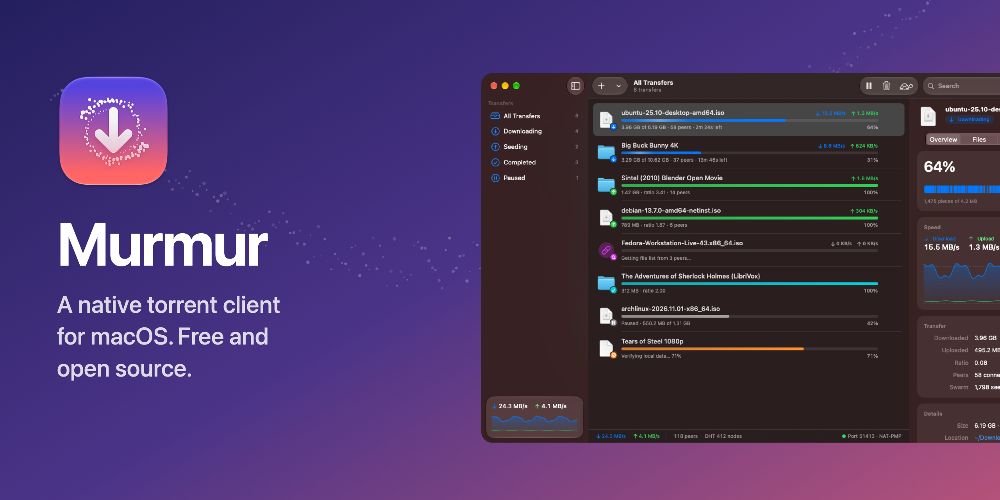
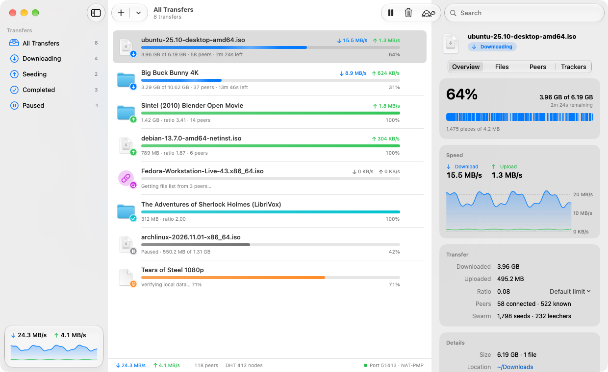
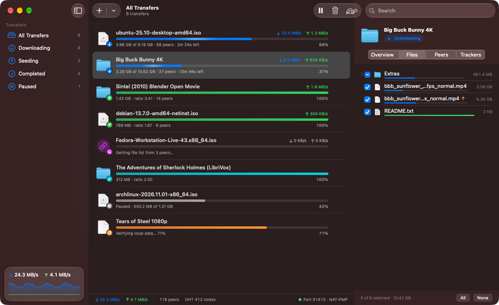
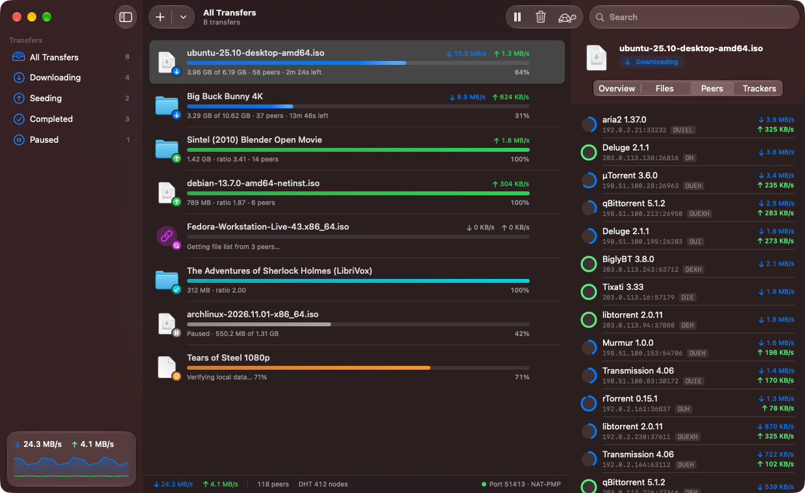
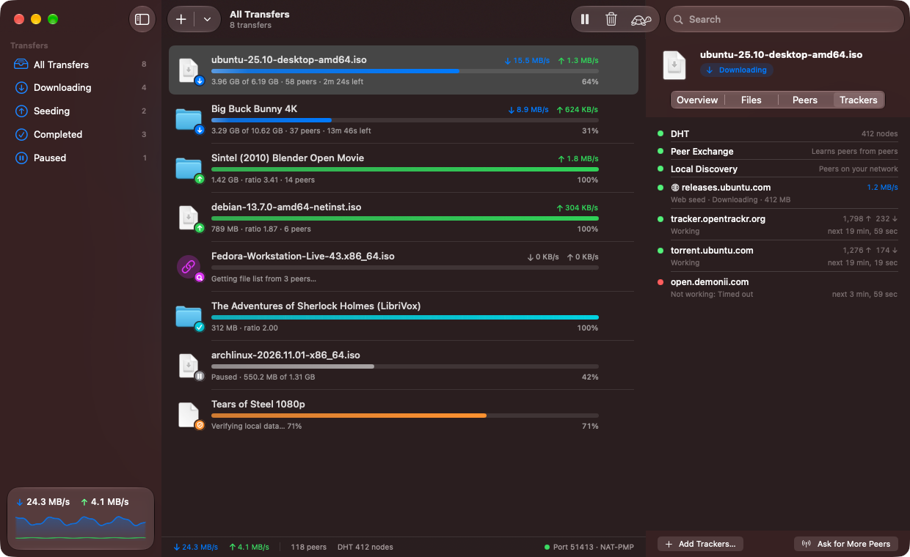
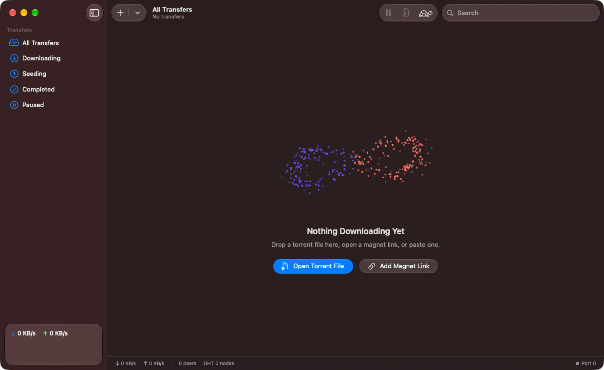
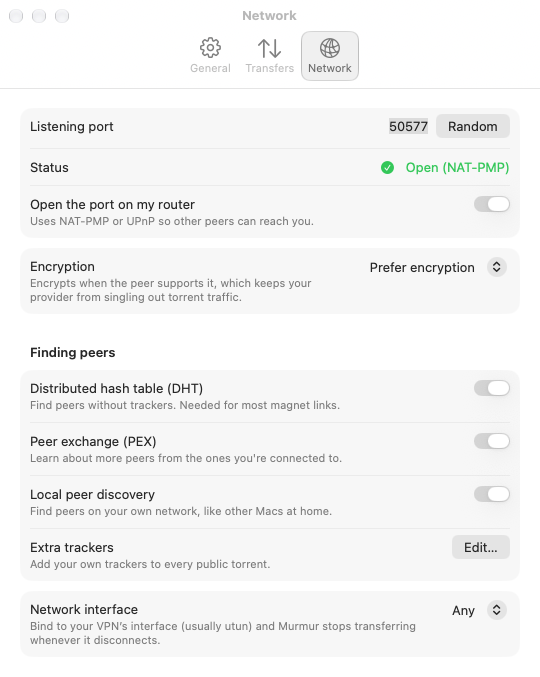

<p align="center">
  
</p>

<p align="center">
  <a href="https://github.com/nearbycoder/murmur/releases/latest/download/Murmur.dmg"><b>Download Murmur.dmg</b></a> ·
  <a href="https://nearbycoder.github.io/murmur/">Website</a> ·
  <a href="#features">Features</a> ·
  <a href="#the-engine">The engine</a> ·
  <a href="#building">Build from source</a>
</p>

# Murmur

A free, open source BitTorrent client for macOS, built natively with SwiftUI and Liquid Glass. Its engine, **MurmurKit**, is written from scratch in Swift with no third-party dependencies.

Click a magnet link, pick the files you want, and watch the swarm do the rest. No ads, no bundled offers, no account, no analytics.

**Requires macOS 26 Tahoe or later.** Releases are signed with a Developer ID and notarized by Apple.

<p align="center">
  
</p>

## Features

- **Magnet links and .torrent files.** Open them from your browser or Finder (one click makes Murmur the default), drop them on the window, or paste them. Murmur notices magnet links on the clipboard and offers to add them.
- **File selection.** Choose files and a location before adding, or change them any time. Set priorities, and download in order to preview media while it arrives.
- **Finds peers anywhere.** HTTP(S) and UDP trackers, the mainline DHT for trackerless torrents, peer exchange, local peer discovery on your network, and HTTP web seeds. NAT-PMP or UPnP opens your port on the router, and you can add your own list of extra trackers to every public torrent.
- **Encrypted connections.** BitTorrent protocol encryption (MSE/PE) is on by default, so your provider can't single out torrent traffic. Prefer it, require it, or turn it off.
- **A real inspector.** Speed graphs, a piece map, connected peers with their client, progress and speeds, and the status of every tracker.
- **Speed limits and Slow Mode.** Global and per-transfer limits, plus a tortoise button (⇧⌘T) for alternative limits that can switch on by itself on a schedule (say, weekdays 9 to 5).
- **Queue and seeding rules.** Limit simultaneous downloads, stop seeding at a ratio globally or per transfer, move transfers up and down the queue, and move finished downloads to another folder automatically.
- **VPN binding.** Bind to an interface such as your VPN's `utun`, and Murmur stops transferring whenever it disconnects.
- **Create torrents** from any file or folder, with your trackers, and start seeding at once.
- **At home on the Mac.** A menu bar extra with live speeds, Dock badge and progress, notifications with *Show in Finder*, Shortcuts actions (add a magnet, pause or resume all, toggle Slow Mode), a watch folder, keep-awake while downloading, and full keyboard control.
- **Quick Look and statistics.** Preview downloaded files from the inspector, and click the speeds in the status bar for session and all-time totals.
- **Resumes where it left off.** Progress is saved continuously and checked against your files on launch, so nothing is downloaded twice.

<table>
  <tr>
    <td></td>
    <td></td>
  </tr>
  <tr>
    <td></td>
    <td></td>
  </tr>
  <tr>
    <td colspan="2" align="center"></td>
  </tr>
</table>

## Keyboard shortcuts

| Key | Action |
| --- | --- |
| ⌘O | Open a torrent file |
| ⌘U | Add a magnet link |
| ⌘N | Create a torrent |
| ⌥⌘P / ⌥⌘R | Pause / resume the selection |
| ⇧⌥⌘P / ⇧⌥⌘R | Pause all / resume all |
| ⌘⌫ | Remove (optionally moving files to the Trash) |
| ⇧⌘R | Show in Finder |
| ⇧⌘C | Copy magnet link |
| ⇧⌘T | Slow Mode |
| ⌘1 … ⌘6 | Filters |
| ⌥⌘I | Show or hide the inspector |

## The engine

MurmurKit lives in [`Packages/MurmurKit`](Packages/MurmurKit). It's a standalone Swift package built on Network.framework, CryptoKit and POSIX sockets.

| Spec | What it covers |
| --- | --- |
| BEP 3 | Peer wire protocol, rarest-first piece picking, endgame mode, tit-for-tat choking with optimistic unchokes |
| BEP 5 | Mainline DHT: iterative `get_peers` lookups, `announce_peer`, and answering other nodes' queries |
| BEP 9, BEP 10 | Magnet links and metadata exchange over the extension protocol |
| BEP 11 | Peer exchange (`ut_pex`) |
| BEP 12, BEP 15 | Multiple trackers, HTTP(S) and UDP |
| BEP 7, BEP 23 | Compact IPv4 and IPv6 peer lists |
| BEP 14 | Local Service Discovery over multicast |
| BEP 19 | HTTP web seeds, fetched with range requests |
| BEP 47 | Padding files (hybrid v1/v2 torrents work through their v1 data) |
| MSE/PE | Protocol encryption: 768-bit Diffie-Hellman and RC4, with plaintext fallback |
| RFC 6886, UPnP IGD | Port mapping |

Every piece is verified against its SHA-1 hash before it's written, peers that send bad data are banned, and paths inside torrents are sanitized so a malicious torrent can't write outside its folder. File handles, hashing and disk I/O run off the networking queue, with token-bucket rate limiting shared across connections.

It's tested with unit tests, swarms of sessions on localhost (magnet → metadata → download → resume, encryption required and disabled, local discovery, per-transfer limits), a web-seed-only download from a local HTTP server, downloads from real swarms (verified against published checksums, including trackerless magnets through the DHT only), and transfers in both directions with [aria2](https://aria2.github.io), in plaintext and with aria2 requiring encryption.

Not yet supported: µTP, the fast extension and v2-only torrents. Pull requests are welcome.

There's a command-line client for trying the engine:

```sh
cd Packages/MurmurKit
swift run -c release murmur-cli "magnet:?xt=urn:btih:…" --dir ~/Downloads [--encryption required]
swift run -c release murmur-cli create ./folder folder.torrent
```

## Building

```sh
brew install xcodegen
git clone https://github.com/nearbycoder/murmur.git && cd murmur
xcodegen generate
open Murmur.xcodeproj
```

You'll need Xcode 26 or later. Run the tests with `swift test --package-path Packages/MurmurKit` and `xcodebuild test -project Murmur.xcodeproj -scheme Murmur -destination 'platform=macOS'`.

`./Scripts/release.sh` archives, signs with Developer ID, notarizes and packages a DMG; `./Scripts/release.sh publish` also tags the version and creates a GitHub release. Bump the version in `Resources/Info.plist` first.

Screenshots come from a demo mode with sample transfers and no networking: `./Scripts/shoot.sh overview out.png [light|dark]` (scenes: `overview`, `files`, `peers`, `trackers`, `empty`). `Scripts/make-og.swift`, `Scripts/render-icon.swift` and `Scripts/make-dmg-background.swift` render the social card, the icon PNGs and the installer background.

### Project layout

```
Packages/MurmurKit/
  Sources/MurmurKit/   The engine: Session, Torrent, PeerConnection, DHT, Trackers, Storage, PortMapper, …
  Sources/murmur-cli/  Command-line client
  Tests/               Unit tests and a localhost swarm test
Sources/Murmur/
  App/                 App entry, settings, the transfer store, demo mode
  Views/               Main window, transfer list, sheets, settings, menu bar extra
  Inspector/           Overview, files, peers and trackers
  System/              Dock, notifications, sleep, watch folder, default app, App Intents
  UI/                  Progress bars, speed charts, piece map, the murmuration animation
Resources/             Icon Composer app icon, Info.plist, DMG layout
docs/                  GitHub Pages site
```

## Legal

Murmur is a general-purpose file-sharing tool and doesn't include any search or content. Use it for things you have the right to share and download, such as Linux distributions, open movies and public domain works.

## License

[MIT](LICENSE) © 2026 Josh Hamilton.
